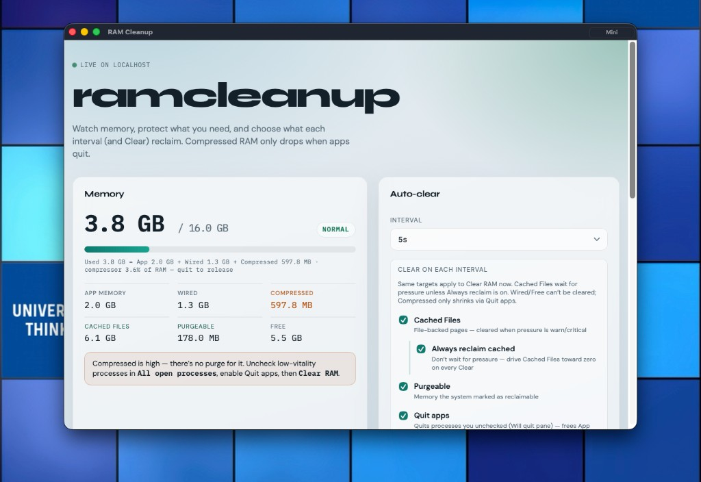
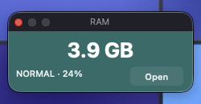

# ramcleanup

macOS RAM monitor and reclaim tool. Watch Activity Monitor–style memory, protect what you need, reclaim cached/purgeable pages, and optionally quit apps to free **App Memory** and **Compressed** RAM.

## Screenshots

### Full window

Live dashboard on localhost: memory breakdown, auto-clear targets, and process keep/quit controls.



### Mini window

Always-on-top widget (top-right). Shows current **Used** memory and pressure; **Open** expands to the full UI.



## What it does

| Goal | How |
|------|-----|
| Drop **Cached Files** / **Purgeable** | Clear with those targets checked (optionally **Always reclaim cached**) |
| Drop **App Memory** / **Compressed** | Enable **Quit apps**, uncheck processes you don’t need, then Clear |
| Wired / Free | Not directly clearable (system / headroom) |

**Memory Used** = App + Wired + Compressed. Cached Files are separate and reclaimable under pressure (or anytime with Always reclaim).

## Quick start

### App (recommended)

Double-click **`RamCleanup.app`** in this folder.

- Opens the **full window** on launch
- Menu bar **RAM** → Show Mini / Open Full Window / Quit
- Title bar **Mini** or in-UI **Mini window** → compact always-on-top widget

Rebuild the app after native changes:

```bash
./native/build_app.sh
open RamCleanup.app
```

### Terminal UI

```bash
python3 ramcleanup.py
```

Keys: `[k]` quit apps · `[r]` cache reclaim · `[a]`uto · `[q]`uit

### Web UI only

```bash
python3 ramcleanup.py --web --open
# or double-click start-web.command
```

## Features

- **Activity Monitor–compatible** stats (App, Wired, Compressed, Cached, Purgeable, Free)
- **Always reclaim cached** — drive file cache down even when pressure is normal
- **Process list** with vitality scores; critical system/session apps are hidden
- Default **Keep**; uncheck to allow quitting when Quit apps is on
- **Auto-clear** interval (5–60s) with the same targets as Clear RAM now
- Native **mini** widget, always on top

## Requirements

- macOS 13+
- Python 3
- Xcode Command Line Tools / Swift (only to rebuild `RamCleanup.app`)

## Project layout

```
ramcleanup.py      # core memory + reclaim + terminal UI
webui.py           # localhost dashboard
native/            # Swift host for RamCleanup.app
RamCleanup.app     # double-clickable app
docs/              # screenshots
```

## Notes

- Compressed memory has no purge API — only quitting owning apps releases it.
- `sudo purge` may run when reclaiming if passwordless sudo is configured; otherwise balloon/pressure relief still applies.
- Config is stored in `~/.ramcleanup/` (protected/released apps, clear targets, logs).
